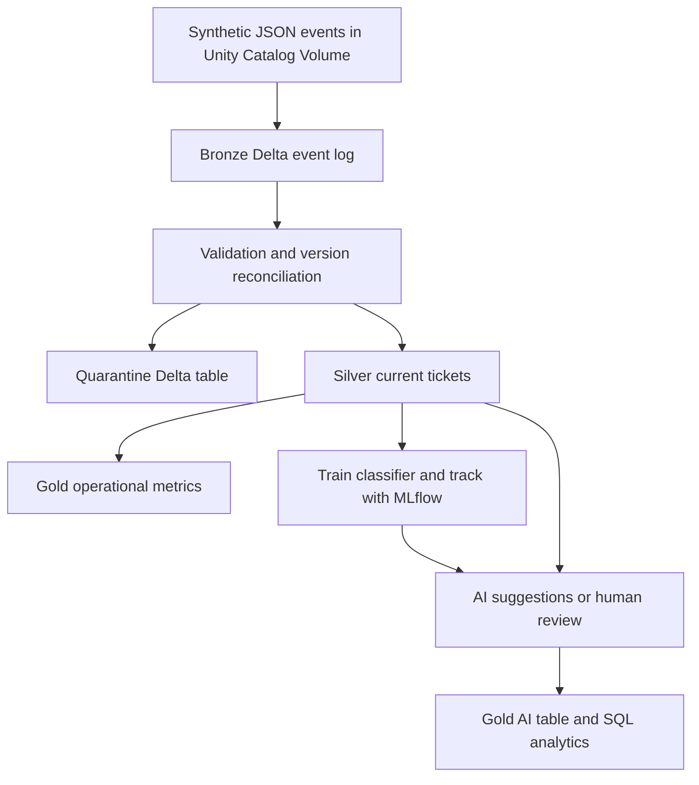

# CaseLake — Databricks AI Ticket Lakehouse

A Databricks-first portfolio project: ingest synthetic support-ticket events,
build reliable Delta tables, and train a real AI classifier to suggest routing
categories. Databricks is the data and orchestration platform; AI consumes the
curated lakehouse instead of being a separate chatbot.

**Stack:** Databricks, PySpark, Delta Lake, Unity Catalog, Lakeflow Jobs,
MLflow, SQL, scikit-learn and Declarative Automation Bundles.

**Business question:** Which tickets need attention, and can a model suggest
billing, account access or delivery routing while abstaining when uncertain?

## What is implemented

| Component | Behavior |
|---|---|
| Bronze | Append-only logical event log, Delta MERGE on canonical payload hash |
| Silver | Latest valid version per ticket; stale replays do not replace corrections |
| Quarantine | Missing values, invalid types/ranges/timestamps, malformed JSON and version conflicts |
| Gold | Category/priority aggregates and separately stored AI suggestions |
| AI | TF-IDF + trained logistic regression, template-separated evaluation and quality gate |
| Human review | Low confidence and out-of-vocabulary text abstain; model never changes assignments |
| MLflow | Parameters, metrics and saved classifier artifact; no model registry claim |
| Orchestration | Four sequential serverless notebook tasks in a deployable bundle |
| Traceability | AI rows retain source event, source Delta version and MLflow run identifiers |



No real customer data, credentials or paid AI API key is required. The model is
supervised machine learning, **not a generative LLM**. Its small synthetic scores
must not be presented as real customer accuracy or proof of production scale.

## Start here

1. [Databricks setup and commands](docs/databricks-runbook.md): Free Edition or
   an existing workspace, Git folder, bundle deployment, verification and cleanup.
2. [Local setup and demo](docs/local-runbook.md): runs actual Spark + Delta,
   trains the same model and records an MLflow run without a Databricks account.
3. [Design and tradeoffs](docs/architecture.md): replay, conflicting versions,
   training boundaries, privacy and failure recovery.
4. [Testing status](docs/verification.md): executed checks and remaining workspace checks.
5. [Interview walkthrough](docs/interview-guide.md): explain the project and its limitations.

## Repository layout

```text
caselake/
  databricks.yml             # Four-task serverless job
  notebooks/                # Ingest, curate, train, score
  caselake/                 # Shared production-path Spark and model code
  sql/analytics.sql         # Operational queries, AI traceability, Delta history
  tests/                    # Spark, Delta, AI and bundle checks
  docs/                     # Runbooks and verification evidence
```

The default fixture contains 130 input events: 120 tickets, exact/stale replays,
one correction and six invalid events. Expected result: **127 unique Bronze
events, 120 current Silver tickets and six quarantine records**. Reprocessing the
same input leaves these counts unchanged. A version-conflict test exercises
quarantine and fallback to the last unambiguous ticket version.

## Portfolio wording

After running locally: “Built a Databricks-oriented ticket lakehouse with shared
PySpark/Delta code, replay-safe ingestion, version reconciliation, quarantine
and a trained text classifier; verified locally with Spark, Delta and MLflow.”

Only after a successful workspace run add: “Deployed and ran the four-task
Databricks serverless job with Unity Catalog tables and MLflow tracking.”

This is a personal portfolio project, separate from employment delivery.
