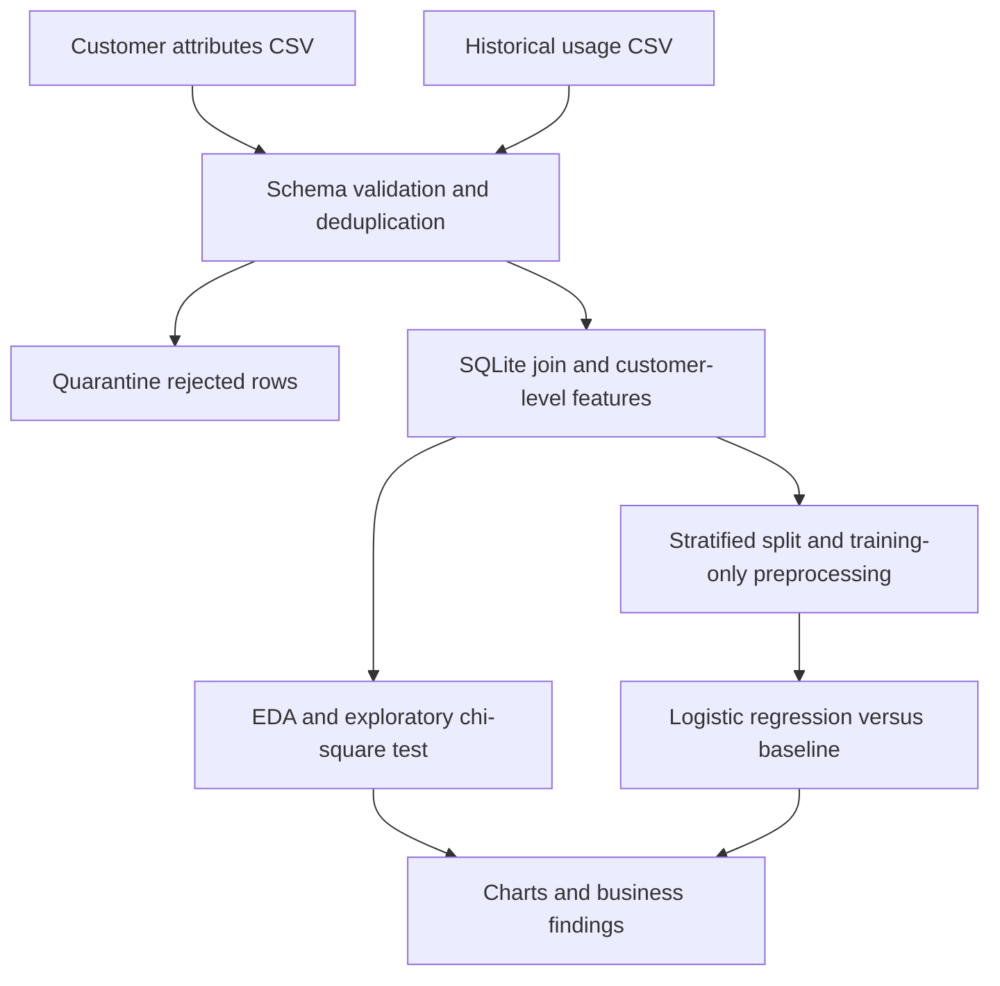

# ClientPulse — Python and SQL Customer Analytics

A reproducible analytics project for a consulting-style question: **which
observed customer behaviors are associated with next-month churn, and can a
baseline machine-learning model rank that risk?** All data are synthetic.

It demonstrates Python, SQL, pandas, NumPy, SciPy, exploratory analysis,
scikit-learn modelling, visualisation, data quality and documented findings.

## What runs



Two-source ingestion produces one row per customer before splitting. Exact
duplicate customer rows are removed; conflicting identifiers fail explicitly.
Negative/out-of-range usage, missing required values and unknown customer IDs
are quarantined. Only November/December 2025 usage is eligible for predicting
the following month; future-period input is rejected to avoid temporal leakage.

The pipeline uses a fixed feature allowlist, median imputation, scaling,
categorical encoding and balanced logistic regression. Preprocessing is fitted
on training customers only. Evaluation includes a majority-prior baseline,
ROC AUC, F1, a confusion matrix, bootstrap AUC intervals and permutation
importance. Imbalance makes accuracy alone a poor reporting choice.

## Run locally

Python 3.11 or 3.12. No credentials, paid services or database installation.

```bash
git clone https://github.com/Jaswanth-16/MyProjects.git
cd MyProjects/clientpulse
python -m venv .venv
```

Activate with `source .venv/bin/activate` on Linux/macOS, or
`.\.venv\Scripts\Activate.ps1` on Windows PowerShell, then:

```bash
python -m pip install -r requirements.txt
python -m pytest tests -q
python -m clientpulse sample --output demo-data
python -m clientpulse analyse --input demo-data --output demo-output
```

The analysis refuses an existing output directory; use another name for reruns.
The default generator produces 600 unique customers, one exact customer replay,
1,200 valid usage records and one intentionally invalid activity record.

## Inspect the deliverables

| File | Purpose |
|---|---|
| curated.csv | SQL-joined customer-level modelling dataset |
| quarantine-*.csv | Rejected source rows for review |
| metrics.json | Quality, model metrics, segment counts and statistical test |
| split.json | Auditable, non-overlapping customer IDs |
| analysis.png | Churn-by-segment and permutation-importance charts |
| report.md | Findings and responsible next steps |
| business-findings.md | Exact sentences usable by EvidenceBrief |

The checked-in [example metrics](docs/example-metrics.json) were produced by
running the code. Re-run locally to reproduce them. [Methods](docs/methods.md)
explain the modelling decisions and limits.

## What not to claim

This is a fixed-snapshot **synthetic** demonstration, not a production churn
system or real client result. It does not establish causality, calibrated risk,
financial benefit, demographic fairness or generalisation. The bootstrap
interval describes the held-out synthetic sample, not all uncertainty in model
selection or a future population. Statistical checks are exploratory and must
not be used as confirmation of a business effect.

The model does not contact customers or automate individual interventions.

## Interview walkthrough

Explain why the join happens before splitting, why IDs/labels are not features,
why transformations are fitted on training data, and what a baseline adds.
Show the quarantine row, held-out metrics and chart. Then describe what would
change for real data: agreed target/snapshot dates, temporal backtests, privacy,
monitoring, independent validation and an approved intervention experiment.
