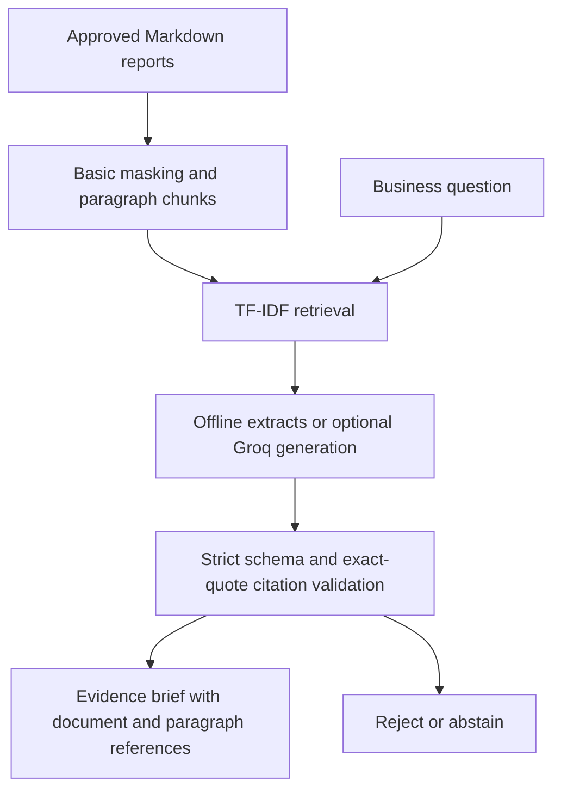

# EvidenceBrief — Source-Grounded Business Briefs

A Python NLP/RAG project for producing reviewable business briefs from approved
Markdown reports and method documents. It retrieves evidence, requests a
structured brief from an optional LLM, and rejects unsupported quotations or
unknown citations before returning output.

**Offline mode is extractive retrieval, not generative AI.** Groq mode uses a
real chat-completions adapter, but requires your own current key/model. A local
HTTP integration test verifies request/response behavior; it is not proof of a
live model run. No existing exposed API key is stored in this project.

## How it works



Features include deterministic chunk IDs, relevance-threshold abstention,
email/long-number masking, suspicious-instruction filtering, bounded context,
structured JSON, a provider timeout, response-size checks and redirect refusal.
An outage or failed validation is never silently reported as a successful LLM
answer. Neither the model nor corpus can execute tools or arbitrary SQL.

The output deliberately contains **only verified source quotes**, not unverified
free-text recommendations. This conservative design makes evidence review easy;
it is not a general-purpose conversational assistant.

## Run without an API key

```bash
git clone https://github.com/Jaswanth-16/MyProjects.git
cd MyProjects/evidencebrief
python -m venv .venv
```

Activate your environment as documented in ClientPulse, then:

```bash
python -m pip install -r requirements.txt
python -m pytest tests -q
python -m evidencebrief --question "Who approves retention interventions?"
python scripts/evaluate.py --output demo-output/evaluation.json
```

Supply your own approved documents with `--corpus /path/to/markdown-folder`.
The default checked-in corpus is synthetic and non-confidential.

## Optional real generative-AI mode

Set `GROQ_API_KEY` and `GROQ_MODEL` in your terminal or secret manager. Choose a
currently available Groq model that supports JSON object mode; free-tier access
and limits depend on the provider/account. Do not paste keys into source files,
GitHub, screenshots or shell commands you plan to publish.

```bash
python -m evidencebrief --provider groq --question "How was model leakage avoided?" --output live-output/answer.json
```

Only use documents approved for transmission to an external provider. Live
results must report `mode: groq_llm`; `offline_extractive` is never a live pass.
The command exits with code 2 for rejected responses and never overwrites an
existing output file.

## Connect ClientPulse findings

After running ClientPulse, copy its `business-findings.md` into your chosen
corpus folder alongside the supplied method/policy documents. Then ask about
customer counts, evaluation results or data-quality findings. The checked-in
ClientPulse finding document is generated from the retained example run.

## Evaluation and limits

The regression evaluator checks a small developer-authored set for evidence
retrieval and abstention. HTTP tests use a local test server, not Groq.
See [verification](docs/verification.md) and [design](docs/design.md).

Exact quoting verifies provenance, **not source correctness or complete answer
relevance**. Keyword overlap can retrieve the wrong paragraph; thresholds are
heuristics. Prompt filtering and masking are best effort, not comprehensive
prompt-injection prevention or PII protection. There is no semantic entailment
judge, embedding service, vector database, production deployment or autonomous
client action in this implementation.

## Interview walkthrough

Show a source paragraph, its stable citation, the retrieved context and the
validated response. Ask an unrelated question to show abstention. Demonstrate
an invented quote being rejected by the tests. Explain why the offline and LLM
paths are explicitly labeled and what still needs a real provider test.
